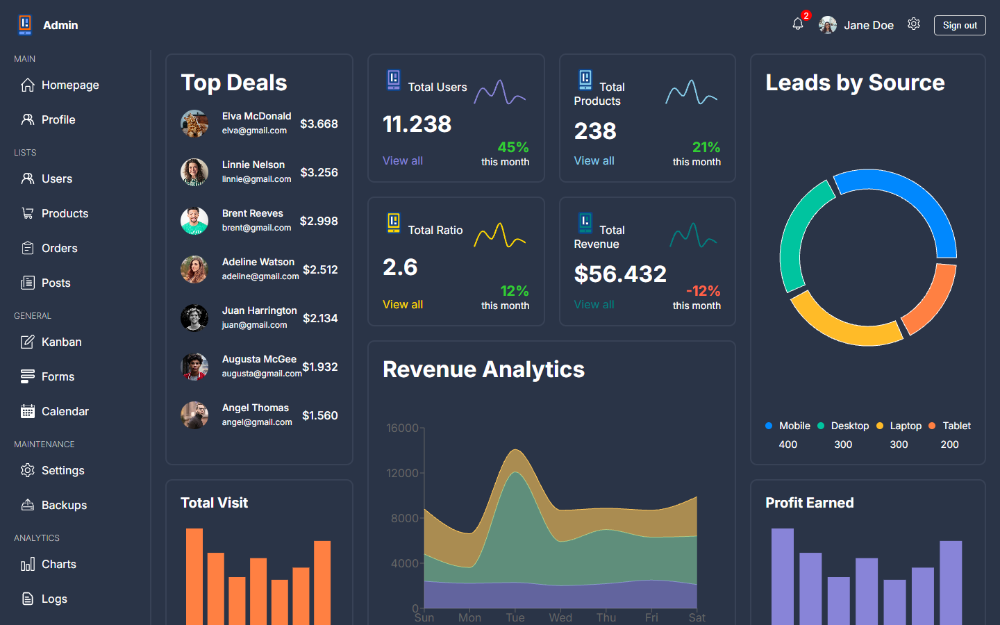
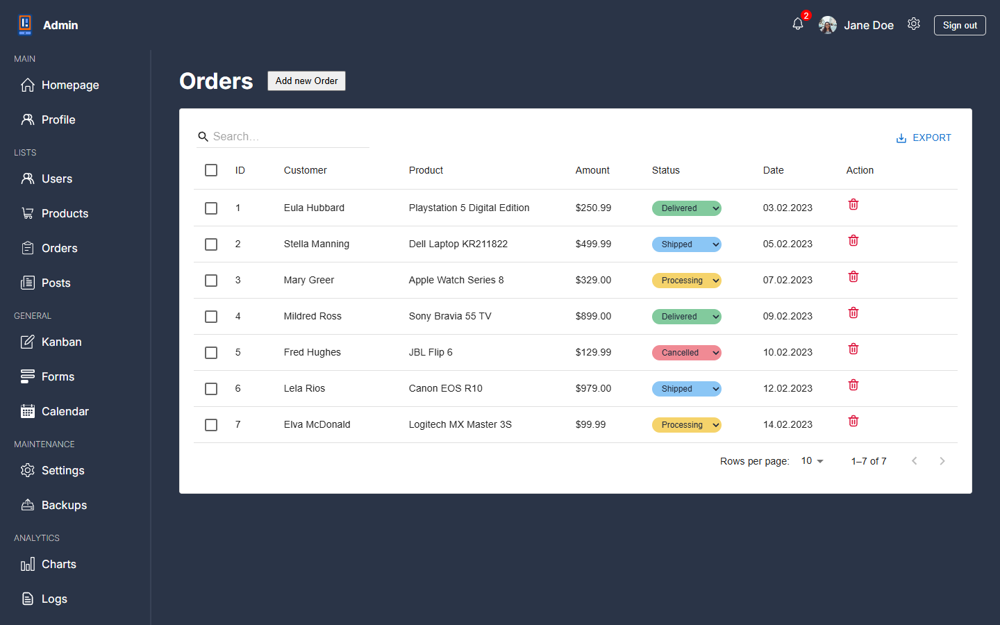
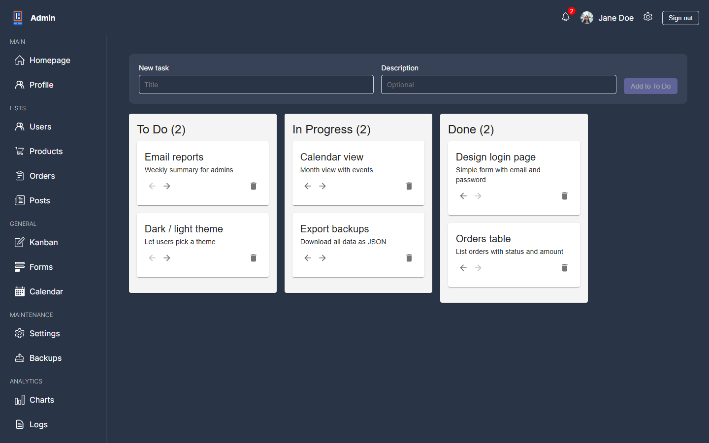
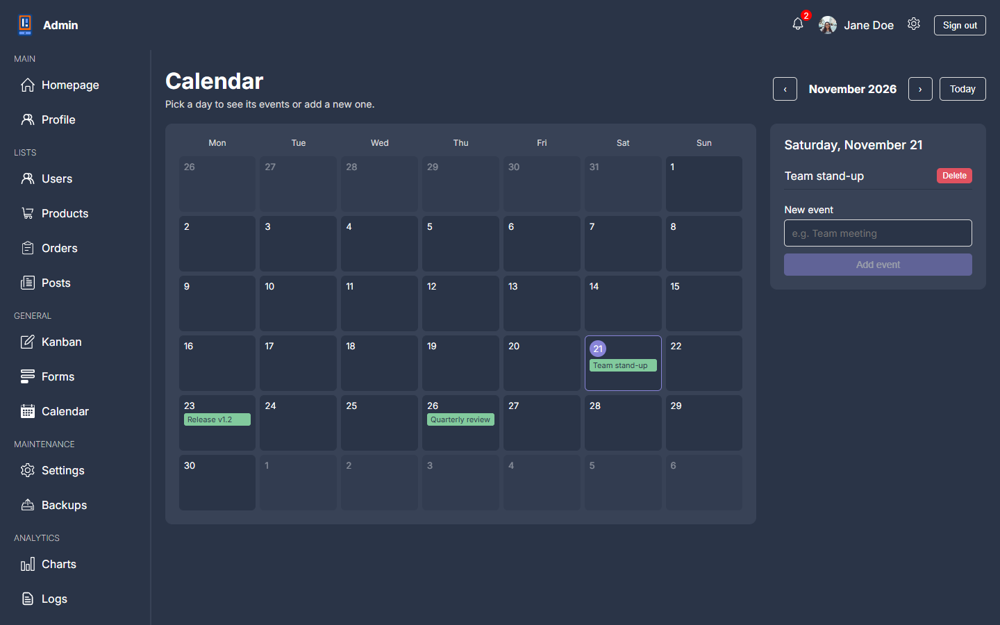
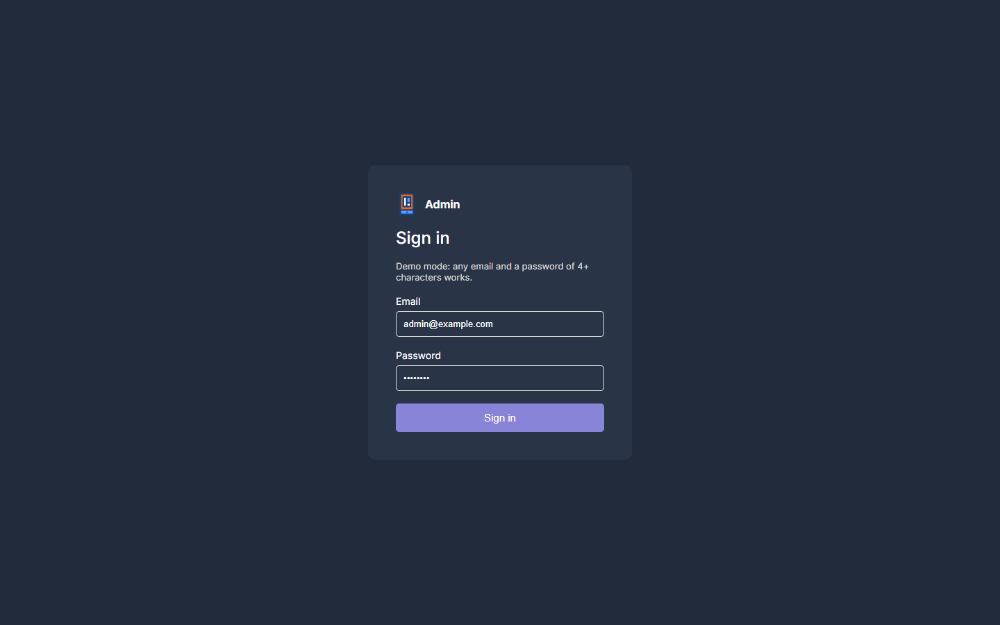

# React Admin Dashboard

An admin dashboard built with React, TypeScript and Material UI. It has users, products and orders tables, a posts feed, a Kanban board, a calendar, charts and an activity log.

There is no backend. All the data is sample data that is saved in your browser (localStorage), so everything you add, edit or delete stays there after a refresh. You can download it as a backup, restore it, or reset it to the sample data at any time.

## Screenshots

| Dashboard | Orders |
|:---:|:---:|
|  |  |

| Kanban | Calendar |
|:---:|:---:|
|  |  |



## Features

- **Sign in**: demo login. Any email and a password of 4 or more characters works, and every page needs you to be signed in.
- **Dashboard**: top deals, stat cards and charts (Recharts).
- **Users and Products**: searchable tables (MUI Data Grid) with add, delete, CSV export and a detail page for each row.
- **Orders**: add and delete orders, and change an order's status straight from the table. The bell in the top bar shows how many orders still need processing.
- **Posts**: write posts, like them and reply to them.
- **Kanban**: add tasks, move them between To Do, In Progress and Done, and delete them.
- **Forms**: a contact form with validation. Sent messages are listed under the form.
- **Calendar**: month view. Pick a day to see its events or add new ones.
- **Charts**: live counts from your users, products and orders, plus the sales charts.
- **Settings**: change the admin name, email and picture shown in the top bar.
- **Backups**: download all data as JSON, restore it from a file, or reset to the sample data.
- **Logs**: every change you make is recorded with the time, and you can search it.

## Getting started

You need Node.js 18 or newer.

```bash
git clone https://github.com/balankdharan/react-admin-dash.git
cd react-admin-dash
npm install
npm run dev
```

Open the address Vite prints (usually http://localhost:5173) and sign in. The login form is already filled in with demo details.

To build for production:

```bash
npm run build
npm run preview
```

The app uses client-side routing, so if you deploy it to static hosting, send every path to `index.html` (for example a rewrite rule on Netlify or Vercel). Otherwise refreshing a page like `/orders` gives a 404.

## Project structure

```
src/
  App.tsx           routes and the signed-in layout
  data.ts           sample data and the sidebar menu
  store/            the data store saved in localStorage
  components/       navbar, menu, tables, charts, kanban, forms, posts
  pages/            one folder per page
  styles/           global and shared styles
```

## Built with

- React 18, TypeScript and Vite
- Material UI and MUI Data Grid
- Recharts
- React Router
- Sass
